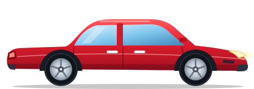
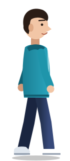

# DOPPLER EFFECT — Interactive Physics Simulation
**Developed and presented by Abdullah Ashraf**

A complete, offline Doppler-effect simulator: a 2D side-view scene where YOU drag the car and the person, a sine wave
drawn through the real wavefronts, fixed on-diagram labels, Web-Audio pitch, calculator, formula sheet, comparison table, applications and quiz.
Plain HTML + CSS + JavaScript — no frameworks, no build step, no internet needed.

---

## 1. How to open it
Double-click **`index.html`** (Chrome or Edge). That's it.

### Optional: run a local server
```bash
cd doppler-effect
python -m http.server 8000      # then open http://localhost:8000
```
(or `npx serve`, or VS Code "Live Server").

---

## 2. Project structure
```
doppler-effect/
├── index.html      page structure (+ the  tags for car / person / logo)
├── style.css       all styling, themes, presentation mode
├── script.js       UI wiring: controls, calculator, quiz, audio buttons, modes
├── physics.js      pure physics: formulas, validation, step-by-step working
├── engine.js       wavefront engine (emission positions, radii, hit detection)
├── audio.js        Web Audio (one oscillator, pitch = observed frequency)
├── scene.js        canvas renderer (background, waves, labels, measurements)
├── content.js      all educational text, formula sheet, table, applications, quiz
└── assets/
    ├── logo/aa-logo.svg          ← AA logo (built-in original artwork)
    ├── car/car.svg               ← red car, side view, facing RIGHT
    ├── character/person.svg      ← person, side view, facing RIGHT
    ├── icons/horn.svg
    ├── backgrounds/              ← put an optional background picture here
    └── sounds/                   ← (reserved)
```

---

## 3. Replacing the pictures (car, person, logo)
All pictures are normal `` tags in **`index.html`**. Change the `src`, nothing else:

```html


```

* Copy your file into `assets/car/` or `assets/character/` and change the `src`, e.g. `src="assets/car/my-car.png"`.
* **Car**: side view, **facing right**, transparent background, wheels touching the bottom edge.
  It is drawn 460 px wide (logical units); the height follows your image's proportions.
* **Person**: side view, **facing right**, transparent background, feet on the bottom edge.
  It is drawn 198 px tall; the width follows the image. The program flips both images automatically when they face left.
* If a picture can't be loaded, the simulation shows a dashed **"NO IMAGE"** box in its place (and the `alt` text on the page).
* **Logo**: replace `assets/logo/aa-logo.svg` (or change the `src` of the three logo `` tags: intro, header, footer).
  The favicon is the `<link rel="icon">` in `<head>`.
* **Background** (optional): set `src="assets/backgrounds/your-background.png"` on `#asset-bg`
  (wide landscape, 2:1, e.g. 1600×800). Leave it empty to use the built-in drawn scene.
  If you use your own background keep the road around **y = 410–610** and the sidewalk around **y = 610–680** (out of 800).

---

## 4. Changing defaults and limits
* **Default values** (440 Hz, 343 m/s, 30 m/s, 30 m/s): `DEFAULTS` at the top of `physics.js`,
  and the `value="…"` of the sliders in `index.html` (`#sl-f`, `#sl-v`, `#sl-vs`, `#sl-vL`) and the calculator inputs.
* **Slider ranges**: `LIMITS` in `physics.js` and the `min`/`max` attributes of the sliders.
  Source velocity must stay below the speed of sound (the app refuses supersonic input).
* **Animation scale**: `PX_PER_M` (pixels per metre, 110) and `SLOW` (slow-motion factor, 130) at the top of `engine.js`.
  A larger `SLOW` makes the waves and the car move more slowly; wavelengths and all ratios stay physically exact.
  Wavelength on screen = `PX_PER_M × λ`; screen frequency = `f / SLOW`.
* **Scene layout** (road height, positions, car/person size): `LAYOUT` in `engine.js`.
* **Colours**: CSS variables at the top of `style.css`; label/wave colours in `COL` at the top of `scene.js`.
* **Text, quiz questions, applications**: `content.js`.
* **Intro length**: the `4800` (ms) in `playIntro()` in `script.js` and the `4.6s` loader in `style.css`.
* **Intro rings** (6 rings): three CSS variables on `.intro-rings` in `style.css` — `--ring-duration` (time one ring takes to expand and fade; larger = slower),
  `--ring-stagger` (delay between rings; keep it about duration ÷ 6 for a continuous flow) and `--ring-delay` (when the first ring starts).
  To add or remove rings, add or remove a `<span style="--n:N"></span>` in the `.intro-rings` block of `index.html`.

---

## 5. How the physics is simulated
* Every wavefront remembers **where the source was when it was emitted** and then grows at the speed of sound.
  A stationary source ⇒ equal spacing. A moving source ⇒ compressed in front (λ′ = (v − vs)/f) and stretched behind (λ′ = (v + vs)/f).
* A moving **listener** does not change the wavelength — only how often wavefronts are met: f′ = f(v ± vL)/v.
* For a moving source the wavelength is different in front of and behind it: **λ front = (v − vs)/f** (compressed) and **λ behind = (v + vs)/f** (stretched).
  "Front" always means *in the direction the source is travelling*. When the source drives away from the listener, the rings that reach the listener are the *behind* rings (longer wavelength).
* The wave you see is a **sine wave drawn through the real wavefronts**: every wavefront crossing the line of sight is a crest,
  so it is stretched behind a moving source and squeezed in front of it, exactly like the picture you supplied.
* **Fixed labels**: V, V′, f, f′, the source/listener speeds and the two wavelength rulers (λ and λ′, drawn at their true length)
  stay at fixed positions on the scene. They never travel with the waves; only the numbers change.
* **Values panel** (under the scene): source/observed frequency, speed of sound, velocities, original / front / behind / observed wavelength, Δf, Δλ, % change, movement directions,
  the formula with numbers and the Doppler condition. It uses the same `physics.js` functions as the animation, calculator and audio.
* **Nothing moves by itself.** Drag the car (modes B, C) or the person (modes A, C) with the mouse or a finger. The object chases the pointer
  at a limited speed: the **Max source / listener speed** sliders set that limit (m/s). Let go and it stops (speed 0).
  The speeds, f′, λ′, formula, calculator, values panel and sound pitch all follow the real movement live.
  Keyboard: click the scene, then ← / → move the selected object (1 = source, 2 = listener).
* Pause freezes everything; grabbing an object while paused resumes. Mode change / Reset fades the scene out and back in.
* General formula used everywhere (scene, calculator, audio): **f′ = f (v + vL)/(v − vs)** with the sign convention
  *listener towards source = +vL, source towards listener = −vs* in the denominator form shown on screen.
* The "Measured from wavefronts" chip counts the wavefronts that really reach the listener and converts the rate
  back to Hz — it agrees with the formula, which is a live self-check.
* Pitch is the **frequency** of the oscillator; volume is the **amplitude**. Distance loudness (optional) only changes volume.

Test values (f = 440 Hz, v = 343 m/s, vs = vL = 30 m/s): listener approaching **478.5 Hz**, listener away **401.5 Hz**,
source approaching **482.2 Hz**, source away **404.6 Hz**.

---

## 6. Controls & shortcuts
| Key | Action | Key | Action |
|---|---|---|---|
| Space | Play / Pause | R | Reset |
| F | Full screen | P | Presentation mode (Esc exits) |
| S | Sound on/off | M | Mute |
| T | Light/Dark theme | | |

Presentation mode hides everything except the enlarged scene and the playback buttons — ideal for a projector.

## 6b. The scenarios
Mode **A** (stationary source, drag the listener): towards / away. Mode **B** (stationary listener, drag the source): towards / away.
Mode **C** (drag either or both): both stationary, source only, listener only, towards each other, away from each other, same direction.
Directions: source right = towards the listener, listener left = towards the source.

`window.DopplerApp` (`sim`, `scene`) is exposed for testing from the browser console.

## 7. Browser support
Google Chrome and Microsoft Edge (current versions). Audio starts only after you click **Play Sound**
(browser rule).
